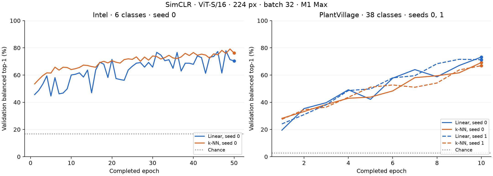
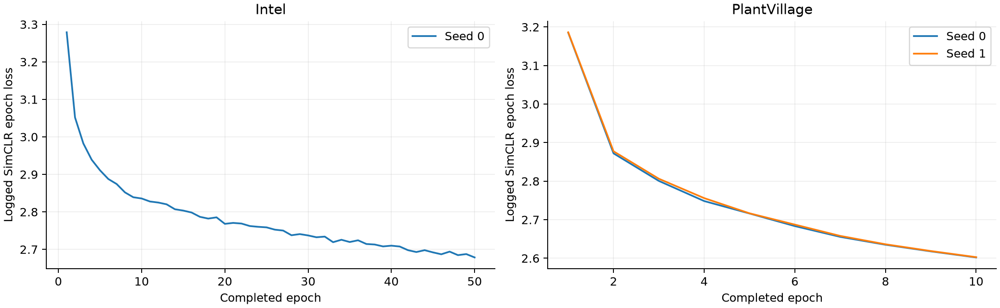

# PlantVillage and Intel: SimCLR validation

The completed training budgets are **50 epochs for Intel (seed 0)** and **10 epochs for PlantVillage (seeds 0 and 1)**. The purpose is to validate the new loaders with full-data learning and evaluation, not to claim convergence or state-of-the-art performance.

## Final results

All accuracies below are percentages, macro-averaged over classes (balanced accuracy for top-1), on the **validation split**. Final epoch scores are reported; the held-out test splits have not been evaluated.

| Dataset      | Epochs | Seed | Linear top-1 | Linear top-5 | k-NN top-1 | k-NN top-5 |
| ---          | ---:   | ---: | ---:         | ---:         | ---:       | ---:       |
| Intel        | 50     | 0    | 70.37        | 99.26        | 76.22      | 98.87      |
| PlantVillage | 10     | 0    | 73.19        | 96.76        | 69.16      | 92.61      |
| PlantVillage | 10     | 1    | 71.28        | 95.58        | 66.87      | 92.07      |

PlantVillage's descriptive mean ± **sample** standard deviation across these two seeds is **72.24 ± 1.35% linear top-1** and **68.01 ± 1.62% k-NN top-1**. Seed 0 selected the endpoint using validation, while seed 1 repeated the fixed 10-epoch budget; this is not two independently prespecified stopping experiments.



Both individual PlantVillage curves are shown. Intel's replayed epochs 49 and 50 replace the earlier versions rather than appearing twice. There is no smoothing. Chance reference is 1/6 (Intel) or 1/38 (PlantVillage). These lines are reference levels, not measured random-encoder results.



This is the harness's logged `fit/loss_epoch` (SimCLR NT-Xent). Intel's replayed epochs replace earlier records.

Runtime: Intel approximately **8 h 38 min**; PlantVillage seed 0 **5 h 44 min 37 s**, seed 1 **5 h 48 min 33 s**.

## Training setup

- Backbone: randomly initialized ViT-S/16, input 224 × 224, embedding dimension 384.
- SimCLR: two independently augmented views; temperature 0.5; MLP projector
  hidden dimension 2048 and output dimension 128.
- Augmentations: RGB conversion, random resized crop (scale 0.08–1.0), horizontal
  flip 0.5, color jitter (brightness/contrast/saturation 0.4, hue 0.1, probability
  0.8), random grayscale 0.2, Gaussian blur (kernel 23, sigma 0.1–2.0, probability
  0.5), ImageNet mean/std normalization. Validation uses RGB conversion, resize
  and the same normalization, without random augmentation.
- AdamW: LR 0.0003, weight decay 0.05, betas (0.9, 0.999); 1% linear warmup
  (start factor 0.01) followed by cosine annealing.
- Batch 32, gradient accumulation 1, FP32, no loader workers, Apple M1 Max GPU
  with 32 GB unified memory. Training shuffles and drops the final incomplete
  batch; validation includes every example. Per epoch, Intel uses 12,608 of
  12,632 images and PlantVillage uses 43,424 of 43,429.
- Online linear probe: detached embeddings, cross-entropy, the installed
  stable-pretraining default LARS optimizer (LR 0.1, eta 0.02, no weight decay)
  with constant LR. Online k-NN: k=10, queue capacity 20,000 training embeddings.
  A moving feature queue is not equivalent to a full frozen-training-set k-NN.

The encoder receives no label supervision through the detached linear probe. Linear accuracy can fluctuate while k-NN and representation learning improve; we retain the complete curve and final score instead of selecting its best spike.

## Reproduction

From the repository root (use a new output/checkpoint directory for each run):

```bash
python -m pip install -e ".[benchmarks]"
python -m pip install 'stable-pretraining @ git+https://github.com/galilai-group/stable-pretraining@ab836bf699a2be712dfcf980a5eb70d36391e876'
export STABLE_DATASETS_ROOT="$HOME/.stable-datasets"
export PROJECT_ROOT="$STABLE_DATASETS_ROOT"
export PYTORCH_ENABLE_MPS_FALLBACK=1
RUN_ROOT="$PWD/benchmark-runs/reproduce-$(date +%Y%m%d-%H%M%S)"
mkdir -p "$RUN_ROOT"

python -m benchmarks.run model=simclr dataset=intelimageclassification seed=0 smoke_test=false training.max_epochs=50 training.scheduler_epochs=150 training.batch_size=32 training.accumulate_grad_batches=1 training.num_workers=0 training.precision=32 wandb.enabled=false checkpoint.monitor=null checkpoint.every_n_epochs=1 checkpoint.dir="$RUN_ROOT/intel/checkpoints" hydra.run.dir="$RUN_ROOT/intel/run"

for SEED in 0 1; do
  python -m benchmarks.run model=simclr dataset=plantvillage seed="$SEED" smoke_test=false training.max_epochs=10 training.scheduler_epochs=50 training.batch_size=32 training.accumulate_grad_batches=1 training.num_workers=0 training.precision=32 wandb.enabled=false checkpoint.monitor=null checkpoint.every_n_epochs=1 checkpoint.dir="$RUN_ROOT/plant-seed$SEED/checkpoints" hydra.run.dir="$RUN_ROOT/plant-seed$SEED/run"
done
```

The loop reproduces the final fixed 10-epoch budgets. Historically, PlantVillage seed 0 selected its endpoint using validation accuracy at five-epoch boundaries; the optional stopping callback used then is no longer included in this PR. The published reproduction uses the observed fixed endpoint, not that selection procedure. The original stopping evidence remains in the local training artifacts.

Recorded software is Python 3.12.2 and stable-pretraining 0.1.9.dev10+gab836bf69. Exact major package versions, metric-source hashes and final-checkpoint hashes are in `results.json`; source archive hashes/split manifests are in `sources.json`. Full local logs, checkpoints and environment dumps remain under ignored `benchmark-runs/`. Those large artifacts are not included in the PR.

## Regenerate and audit the evidence

```bash
# Plot from the included, compact numeric evidence; no datasets/checkpoints needed:
python -m benchmarks.plantvillage_intel_results --plot-only
# Re-export original local artifacts and then plot:
python -m benchmarks.plantvillage_intel_results --artifact-root benchmark-runs \
  --source-archives "$HOME/.stable-datasets/downloads"

# Existing dataset tests:
python -m pytest stable_datasets/tests/images/test_plant_village.py \
  stable_datasets/tests/images/test_intel_image_classification.py
```

## Limitations

PlantVillage partitions rank full archive image paths within each class. They are disjoint by path, not by physical leaf, acquisition session, or image content. The source now provides leaf-group metadata, but this builder does not use it; changing to a group-aware split would define a new benchmark and require new training. Captures of the same leaf and near-duplicates may cross splits. Both datasets have collection biases; performance on these validation splits does not establish field performance or generalization to a new camera/domain. The tests do not establish pixel-duplicate or leaf-group independence. No supervised baseline, final held-out-test evaluation, or convergence claim is made.

## Evidence downloads

- {download}`Epoch metrics CSV <epochs.csv>`
- {download}`Final results and environment <results.json>`
- {download}`Source archive hashes and split digests <sources.json>`

## Local verification (October 21, 2026)

The existing dataset and benchmark tests are retained. Additional test files and the optional stopping callback added during preparation were removed from the PR at the author's request. The earlier full-source audit checked all 71,339 selected images, exact split counts and RGB builder output; its snapshot hashes and split digests remain in `sources.json`. This historical audit is distinct from the currently included synthetic dataset tests.

Ruff lint/formatting and applicable pre-commit hooks passed during preparation. Sphinx HTML builds with 31 pre-existing baseline diagnostics, including a missing `CONTRIBUTING.md` include; no new diagnostics were introduced on the edited pages. The complete network-downloading repository test suite was not run, and no new-head GitHub CI result is claimed before publication.

Developed with the help of Codex. I reviewed and verified all code, results and text.
